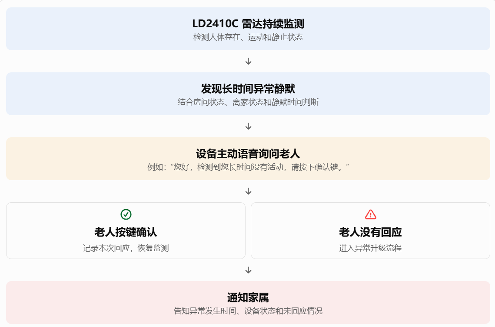
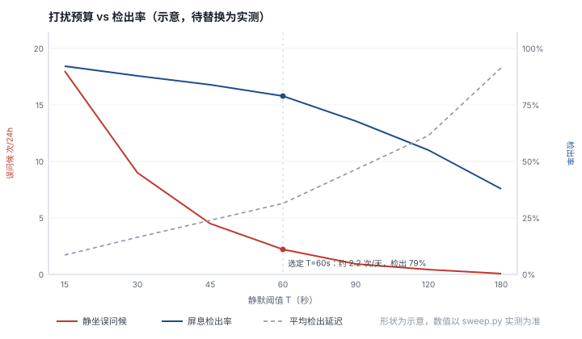
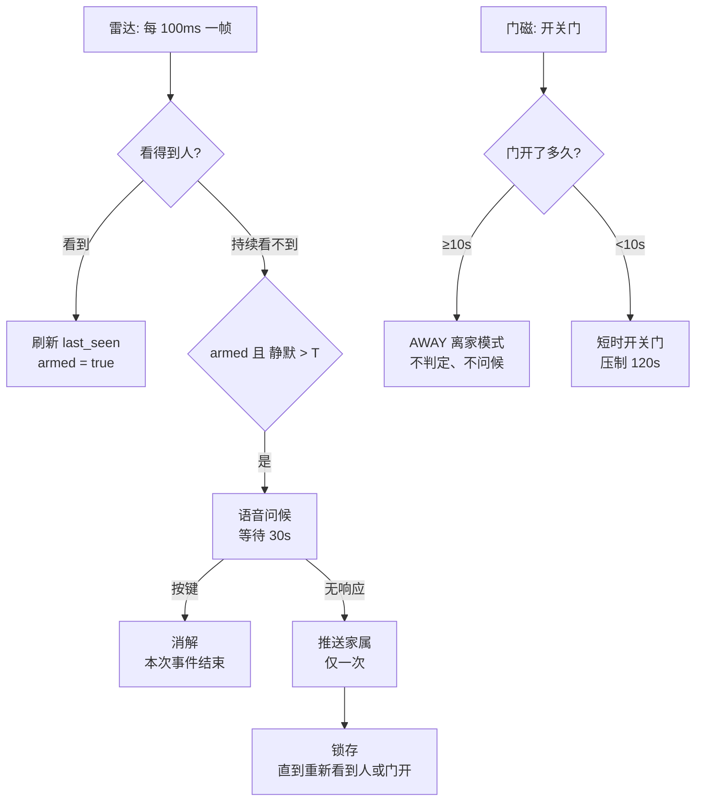
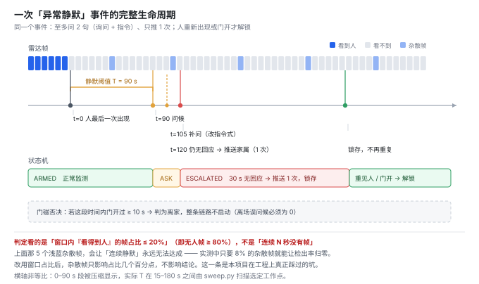
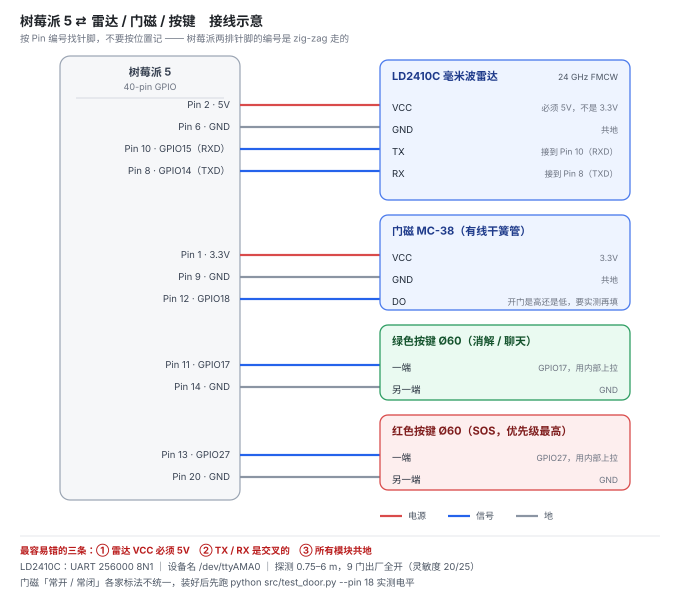

# 守护星 Guardian — 居家老人「异常静默」确认终端

> 一个桌面盒子：雷达发现「该有人在的房间，人忽然探测不到了」，先开口问一句；老人拍一下按键就消解；不问第二次，也不叫醒子女。**它不做跌倒识别**——它回答的是另一个问题：*最坏情况下，多久一定有人知道。*
>
> **懂分寸、不瞎报、能救命。** 三句话对应三件事：报警前先问、同一次只打扰一次、问不到人才找人。

**成本三个口径**（答辩时分开说，混着说会被当成虚报）：

| 口径 | 金额 | 含义 |
|---|---|---|
| 外围器件 | **157 元** | 实际采购申请额，不含主控。清单见 [hardware/采购申请单.md](hardware/采购申请单.md) |
| 整机 DIY | 约 720 元 | 含树莓派 5 的这台样机 |
| 量产形态 | 约 150 元 | 换 ESP32-S3 的整机估算，见 [docs/ESP32迁移指南.md](docs/ESP32迁移指南.md)（**L1 交付后再动**） |

📄 **项目主页**：<https://lsf06.github.io/Guardian-Star-Elderly-Care/> —— 仓库根目录的 [`index.html`](index.html)，图片在 [`assets/`](assets/) 本地引用，双击即可离线打开。`github.io` 国内访问时快时慢，**演示请用本地文件，不要在现场赌网络**。

它给的是一个**有时间上限的承诺**，而不是一句"我很准"：

| 场景 | 最坏多久有人知道 | 靠什么 |
|---|---|---|
| 人从雷达里消失（呼吸停止、滑到地上） | **约 2 分钟** | 静默检测 + 语音确认 |
| 人还在，但动不了也不应答 | **约 13 小时** | 每天 9:00 / 20:00 的主动点名 |
| 设备被拔掉 / 坏掉 | **当天**（前提：家属端在核对"今天该收到一条"） | 每日平安推送 |

第三行是这套设计最实用的副产品：**市面上大量设备不是坏掉的，是被老人嫌烦拔掉的。** 被拔掉的设备是"安静地消失"，而这台每天报一次平安，它一沉默，家属当天就知道。

> **第三行有前提，必须一起说。** "当天知道"不是设备自己报出来的——断电后它发不出任何消息。
> 成立条件是：配了 `PUSHPLUS_TOKEN`、家属每天确实收到一条「今日平安」、且**有人知道"每天都该有一条"**。
> 这是一条使用约定，不是设备能力。PushPlus 也只回"已受理"，没有"已读"，所以它是"大概率送到"，不是"确认收到"。
> 送达链路目前的真实成色见 [docs/工程风险与整改清单.md](docs/工程风险与整改清单.md) 第三节。

> 表中三个数字是**设计值**——由状态机逻辑推得，不是实测统计。硬件到货后按 [docs/边界与指标.md](docs/边界与指标.md) 的测法逐项回填，届时把"约"改成实测区间。**在没测之前，不要在答辩里把它们说成实测**：13 小时那个是逻辑值，2 分钟那个取决于摆放位置与阈值 T。

## 它怎么工作（一张图）



主线只有一条：**雷达在看着 → 长时间没动静 → 先开口问 → 按了就翻篇，没按才找人**。
图里是「异常静默」这一条；每天 9:00 / 20:00 的点名是另一条独立入口，走的是同一个确认动作。
更细的边界（哪些情况它**不会**响）在 [docs/项目说明书.md](docs/项目说明书.md)。

## 文档导航（按场景找，不用通读）

| 你想干什么 | 看哪份 |
|---|---|
| 没硬件，30 秒跑起来看看 | 本文「快速开始」↓ |
| **硬件到货当天按什么顺序验** | **[docs/硬件到货当天_checklist.md](docs/硬件到货当天_checklist.md)** —— 7 个已知坑 + 1 组参数说明、执行顺序、卡住时发什么 |
| **答辩怎么讲、被追问怎么答** | **[docs/答辩问答.md](docs/答辩问答.md)** —— 上半是 PPT 五页 + 三分钟逐字稿 + 彩排清单，下半是 10 条追问 |
| **上台那 3 分钟手上做什么** | **[docs/答辩稿_现场演示.md](docs/答辩稿_现场演示.md)** —— 五个场景的敲键顺序、台词、四句不能说、事故预案 |
| 从零把它做出来（4 阶段，每步带验收） | [docs/从零到一实现步骤.md](docs/从零到一实现步骤.md) |
| 产品是什么、怎么摆、哪些情况**不会**响 | [docs/项目说明书.md](docs/项目说明书.md) |
| 为什么做、和竞品差在哪、成本与风险 | [docs/项目策划书.md](docs/项目策划书.md) |
| 指标怎么定、边界划在哪 | [docs/边界与指标.md](docs/边界与指标.md) —— 第一节是「问题 → 响应 → 证据」对照表 |
| 谁付钱、怎么收费、值不值得做 | [docs/商业模式画布.md](docs/商业模式画布.md) —— 六模块一页，没验证的都标了【假设】 |
| 每个功能拿什么证明、哪些还没跑 | [docs/测试记录.md](docs/测试记录.md) —— 五字段模板 + 已执行的命令与原始输出 |
| 拿到外部教程或别人的代码，能不能照做 | [docs/外部教程核对表.md](docs/外部教程核对表.md) —— 操作层可抄、代码层别混，附 Vosk 正确接入命令 |
| 外部评审说的哪些是真的 | [docs/工程风险与整改清单.md](docs/工程风险与整改清单.md) —— 逐条对代码，标了成立 / 部分成立 / 误读 / 不适用 |
| 采集当天打印，边测边填 | [docs/采集记录表.md](docs/采集记录表.md) |
| 要买什么、怎么跟老师报 | [hardware/采购申请单.md](hardware/采购申请单.md) —— 必购 157 元 / 可选 139 元 / 明确不买的三种 |
| **给老师看的飞书多维表格** | **[feishu/README_多维表格说明.md](feishu/README_多维表格说明.md)** —— 仓库内 `feishu/*.csv` 是 11-04 的只读快照，**已停止自动同步** |
| 量产形态（ESP32-S3）怎么换 | [docs/ESP32迁移指南.md](docs/ESP32迁移指南.md) —— **L1 交付后再动** |

<details>
<summary>项目简介（约 200 字，可直接粘进申报表 / 答辩 PPT 首页）</summary>

> “守护星”是独居老人的桌面异常静默关怀终端。不做跌倒识别，专防“人出事了却没人知道”：LD2410C 雷达判断人是否从房间消失，门磁否决正常出门，两条件同时成立才问候；老人拍一下按键即消解，不惊动家属；无回应才升级通知。承诺是“最坏 2 分钟有人问、最坏 13 小时有人点名”，不是“很准”。对话用大模型，不参与安全判定。树莓派 5 原型，外围器件约 157 元；ESP32 量产整机约 150 元。

</details>

---

## 为什么不是「更准的雷达」

市面上不缺雷达（萤石、华为、小米，两三百到两千元；DIY 也能做跌倒告警）。它们共同的失败方式不是测不准，而是——**被拔掉电源**：

> 问清楚设备有没有「报警前语音二次确认」——直接疯狂呼叫子女的，大概率撑不过一个月就被静音。

所以本项目不参与「识别率」的竞赛，它换了一个目标函数：**在「每天最多打扰 N 次」这个约束下，能检出几成、延迟多少？** 这是一个工作点选择问题，不是识别准确率问题。本仓库的核心产出，就是这条权衡曲线。竞品分层、背景数据与价格锚点见 [docs/项目策划书.md](docs/项目策划书.md)（价格只给区间不点型号单价；需要具体报价时引策划书里的政府采购中标价 550 元/台）。

---

## 核心结果



> 曲线形状为**示意**，数值以实测为准。三条线：误问候次数/24h、屏息检出率、平均检出延迟。
> 横轴为静默阈值 T（15–180 秒）。`python src/sweep.py data/xxx.csv` 生成。

| 指标 | 目标值 | 实测 |
|---|---|---|
| 静默检出延迟 | ≤ T + 5 s | 待填 |
| 正常静坐误问候 | ≤ 2 次 / 天 | 待填 |
| 开门离场误问候 | **0 次** | 待填 |
| 屏息检出率 | ≥ 80% | 待填 |
| 问候消解成功率（按键） | ≥ 95% | 待填 |
| 最长无人知晓（**人在场**、不应答） | ≤ 13 h | 13 h（逻辑值，非实测） |
| 每日点名误打扰 | 2 次 / 天，时刻可预期 | 待填 |
| 单次问候的打扰成本 | 1 次语音，0 次推送 | — |
| **跌倒检出** | **明确不支持** | — |

最后一行不删。一份敢写「我不做什么」的指标表，比一份全是优点的表可信。完整 13 项（含定义与测法）见 [docs/边界与指标.md](docs/边界与指标.md)；「实测」列现在是空的，**这是有意的：没有实测数据之前不填数字。**

---

## 工作原理



时间维度上，一次事件是这样走的——**这张图是答辩时最好讲的一张**：



注意那五个浅蓝色的小格：真实的雷达每隔十几秒就会冒一帧「看到人」。如果按「连续 N 秒没有帧」判定，这些杂散帧会把计时器永远打断，检出率直接归零。所以本仓库判定的是**窗口内无人帧占比 ≤ 20%**，而不是连续静默。

四个设计约束，缺一个就会退化成「会被拔电源的设备」：

1. **锁存**：同一次静默只问一次、只推一次，人重新出现或门开才解锁。
2. **心跳**：5 秒收不到任何雷达帧 → 判「设备异常」，不判「人消失」。
3. **启动自检**：上电 60 秒未见人 → 提示检查摆放位置，避免「看起来在工作、其实一直看不见」。
4. **每日点名**（9:00 / 20:00）：雷达看得见人，但看不出他还能不能动。没有它，「倒在地上还在呼吸」这个最危险的场景设备永远一言不发——点名把承诺从无界变成有界，顺带让「被拔掉」变成家属可观测的事件。

> 点名的那句话是可选的第七段录音 `audio/checkin.wav`；没录会退回 `ask.wav` 顶上，不会变成哑巴。

---

## 关于「AI 陪聊」（可选，不属于安全路径）

三条规则写在代码里也写在边界里：**①** 处于问候/升级状态时按键一律判消解，事件结束后按键才唤醒聊天——老人不需要记规则；**②** 安全播报走三级降级（本地 WAV → edge-tts → 打印），问候/消解/升级三句**绝不回退联网 TTS**；**③** 语音识别只做输入端、永不参与判定——`arecord` 录 5 秒 → Vosk 离线识别 → `deepseek-chat` → 回复合成，限制三条：**5 秒定长、需相对安静、只对标准普通话**。识别错了最多是聊得不好，不会漏救。

- 没装 `vosk`：自动退回 `--chat-mode text`，键盘输入，不报错
- `~/.asoundrc` 把默认设备指给音箱后，`arecord` 会打开只能播的卡、录到空文件**且不报错**，所以麦克风要用 `GUARDIAN_MIC_DEV` 单独指定：

```bash
arecord -l                                  # 查麦克风 card 号
export GUARDIAN_MIC_DEV=plughw:2,0          # 填上，否则录到空的
export GUARDIAN_VOSK_MODEL=/path/to/vosk-model-small-cn-0.15   # 模型不在默认位置时
```

**合规提示**：若对外提供拟人化情感陪伴服务，需遵守《人工智能拟人化互动服务管理暂行办法》（2026-07-15 施行）的标识、安全评估等义务。作为课程 / 研究原型不对外提供服务时通常不触发，但演示文案里不要承诺任何医疗建议。

---

## 快速开始（无需任何硬件）

```bash
git clone https://github.com/lsf06/Guardian-Star-Elderly-Care.git
cd Guardian-Star-Elderly-Care     # 注意：目录名是仓库名，不叫 guardian
python src/mock_run.py            # 虚拟时钟跑完整剧本，约 3 秒出结果
python src/mock_run.py --verbose  # 逐秒打印状态机内部变量
python src/demo_keyboard.py --no-gpio --no-audio   # 键盘模拟传感器，现场演示用（1 人消失 / 5 按键 / 3 开门）
python src/selftest.py            # 协议层自检：用真实报文校验帧解析
python src/preflight.py           # 环境体检：依赖 / 7 句语音 / 串口 / 声卡（缺硬件只 WARN）
```

> `mock_run.py` 是**自动播**的，`demo_keyboard.py` 是**你按一下它动一下**的。
> 后者跑的是同一个 `Guardian`，只是把 90/30/15 秒压成 15/8/4 秒，方便站台上不冷场。

> 所有命令都必须在**仓库根目录**执行，否则 `import` 找不到 `src/`，报 `ModuleNotFoundError`。

`mock_run.py` 会依次模拟：上电无人 → 静坐 → 屏息 → 按键消解 → 开门离家 → 回家 → 无人且门关 → 无响应升级 → 锁存不再重复。
**最后一项是回归测试**：升级之后继续跑 5 分钟静默，必须一条事件都不产生。

## 接真硬件



```bash
pip install pyserial
python src/test_radar.py --port /dev/ttyAMA0     # 应先看到 10 帧/秒
python src/test_door.py --pin 18                 # 实测门磁电平，记下开门时是 1 还是 0
python src/guardian_main.py --port /dev/ttyAMA0 --pin-door 18 --pin-button 17 --pin-sos 27
```

树莓派 5 的 UART 配置（**只加这一行**）：

```ini
# /boot/firmware/config.txt
dtparam=uart0=on
```

> 不要加 `dtparam=uart0_console`。那行会把这个串口变成登录控制台，正好占掉你要用的口，程序会一直报「设备被占用」。
> Pi 5 上设备名是 `/dev/ttyAMA0`，**不是** `ttyS0`，也**不是** `serial0`（它指向 debug 排针）。

门磁用 `gpiozero` 读（Pi 5 上 `RPi.GPIO` 会直接崩，GPIO 已移到 RP1 芯片）。
门磁「常开/常闭」的标签各家标法不统一，**只信 `test_door.py` 实测**：开门电平若不是 1，启动时加 `--door-open-level 0`。
红键必须显式传 `--pin-sos 27`——代码默认 `None`（没接），不传则红键按下去没反应。

完整的到货当天顺序、7 个已知坑与距离门参数说明见 **[docs/硬件到货当天_checklist.md](docs/硬件到货当天_checklist.md)**。

## 采数据（六组，这一步才是项目本身）

> `data/_synthetic_demo.csv` 是**构造出来的合成数据**，只用来看脚本能不能跑通。
> 它跑出来的「检出率 100%、误问候 0 次」一个字都不能写进报告。
> 真实数据必须自己采，文件名用 `data/guardian.csv`（已在 .gitignore 里，**采完本地另存两份备份**）。
> 同理 `data/_synthetic_sweep_result.csv` 是合成数据的扫描结果，只能用来确认脚本没坏。
> 真机上跑出来的应该是根目录的 `sweep_result.csv`——**如果只有前者，说明你还没采。**

六组，合计约 2.5 小时。**顺序不要换，每组做两轮，每轮前重录一次 `empty`，同一天采完**（跨天底噪不可比）。
真机采集当天请打印 `docs/采集记录表.md`，边测边填环境与异常——这两项脚本记不下来，但它们决定数据是否作废。

```bash
python src/capture.py --label empty      --minutes 2    # 空房底噪
python src/capture.py --label sit        --minutes 120  # 正常坐着看电视/玩手机，可拆多段累计
python src/capture.py --label moving     --minutes 3    # 房间里正常走动
python src/capture.py --label breathhold --minutes 3 --event-at 20
python src/capture.py --label lie        --minutes 3 --event-at 20
python src/capture.py --label exit       --minutes 3 --event-at 20 --pin-door 18
```

**`sit` 必须累计 ≥ 2 小时**：`sweep.py` 拿它外推「误问候/24h」，5 分钟外推 288 倍是答辩一戳就破的假数字。它不是额外负担——把设备放着别管，两小时是自然流逝的。

开始前会先自检 3 秒。**0 帧就退出，并打印六项排查顺序**——波特率写成 115200、TX/RX 没交叉、忘了共地，表现都是「安静地跑完 3 分钟、写出 0 行」，然后你才会发现。

每个 `--event-at` 对应的动作：

| label | 第 20 秒你要做的事 |
|---|---|
| `breathhold` | 屏住呼吸，尽量不动，能屏多久屏多久（**核心实验，决定项目上限**） |
| `lie` | 躺到地上，不动，但**保持正常呼吸** |
| `exit` | 起身、开门、走出去，在门外待满剩下的时间 |

`lie` 的预期结果是**雷达仍然看得见你**（state=2）。这个负结果不是失败，是你「不做跌倒检测」这条边界的证据。

采完：

```bash
python src/sweep.py data/guardian.csv --ts 30,45,60,90,120,180
```

输出会自己提醒两件事：`sit` 样本不足 2 小时的话，`误问候/24h` 是外推的，答辩别报这个数；`empty`、`lie`、`exit` 三列必须为 0，不为 0 说明门磁否决或空房判定没生效——那比误问候严重得多。

## 硬件

| 件 | 型号 | 价格 | 作用 |
|---|---|---|---|
| 主控 | 树莓派 5（已有） | — | 状态机 / 语音 |
| 雷达 | HLK-LD2410C | 25–35 | 24GHz FMCW，UART 256000 8N1 |
| 门磁 | 有线干簧管 MC-38 | 3–8 | 否决「出门」 |
| 按键 | Ø60 自复位 ×2（绿/红） | 12–24 | 消解 / 唤醒；红键 SOS |
| 外壳 | ABS 150×100×70 | 12–20 | — |
| USB 音箱 | 免驱小音箱 | 15–25 | 播报出口（Pi 5 无耳机孔，**必需**） |
| 其他 | 铜箔胶带、100µF、杜邦线、Ø60 开孔器 | ~45 | 屏蔽后瓣、稳压、开按键孔 |

> 0.96" OLED **不采购**：代码里没有任何屏驱动，装上是黑屏（BOM 已把这一条划掉）。要加显示，先实现驱动再谈。

**摆放是硬约束**：LD2410 的 G0/G1（0–1.5 m）静止门限出厂为 0，静止检测实际从 **1.5 m** 起。
放在茶几（0.5–1.2 m）会「对着人报无人」，然后每 T 秒问一次。**建议 2–4 m，高度 60–90 cm，朝前不朝上。**
详见 [hardware/BOM.md](hardware/BOM.md)。

---

## 边界（请连同结论一起引用）

- **不做跌倒识别。** 倒在地上的人仍在呼吸，雷达照样看得见。本方案检测的是「从看得见变成看不见」；该场景由每日点名兜底（最坏 13 h）。
- **一台只覆盖一个房间。** 卫生间、跨房间是盲区（门磁也只贴一扇门）。
- **断电、断网即失效**（断网只失去远程通知）。安全播报使用本地预录 WAV，不依赖云 TTS。
- **需要 ≥1.5 m 摆放距离**，因此不能放茶几。
- 不宣称符合 MZ/T 238—2025（该标准为**推荐性**），仅参照其功能框架，且不覆盖跌倒检测部分。

完整 10 条含理由的版本见 [docs/项目说明书.md](docs/项目说明书.md) 第五节。

---

## 目录

```
├── src/                   # 逻辑与协议，无硬件即可运行
│   ├── ld2410.py          # 协议解析 + 帧解码（零依赖，可单独复用）
│   ├── guardian.py        # 状态机（纯逻辑，不碰硬件，可单测）
│   ├── guardian_main.py   # 硬件入口：串口 + GPIO + 语音
│   ├── capture.py         # 采集，按 data/schema.md 落盘
│   ├── sweep.py           # 扫出打扰预算曲线（核心产出）
│   ├── mock_run.py        # 无硬件跑完整剧本（含回归测试）
│   ├── demo_keyboard.py   # 键盘模拟传感器，现场演示（跑的是同一个状态机）
│   ├── selftest.py        # 用真实报文校验解析
│   ├── preflight.py       # 环境体检：依赖 / 语音 / 串口 / 声卡
│   ├── test_radar.py      # 雷达连通性 + 0 帧排查
│   ├── test_door.py       # 门磁电平实测
│   └── voice.py           # 本地优先播报 + LLM 对话（非安全路径）
├── tools/
│   ├── audio_kit.py       # 录音体检（不需要声卡）+ m4a → WAV
│   ├── make_audio.py      # 临时 TTS，答辩前必须换成真人
│   ├── plot_sweep.py      # 按 sweep 结果画指标图
│   ├── make_qr.py         # 生成主页二维码
│   ├── feishu_sync.py     # 已停用（2026-11-09）：曾按天同步开发日志到多维表格
│   └── feishu_export.py   # 已停用：导出四张 CSV 快照
├── audio/                 # 七句真人语音：ask / ask_again / resolved / fault / away / sos / checkin
├── hardware/
│   ├── BOM.md             # 采购、摆放、验收顺序、要不要焊接
│   ├── 采购申请单.md       # 给老师看的必购/可选清单（157 / 139）
│   └── wiring.svg         # 接线图（Pin 编号对齐，含三条易错点）
├── docs/
│   ├── 项目说明书.md       # 产品是什么 / 怎么摆 / 什么情况下不响 / 规格
│   ├── 项目策划书.md       # 背景数据 / 竞品分层 / 成本 / 风险 / 四周路线
│   ├── 从零到一实现步骤.md  # 分四个阶段的动手清单，每步带验收标准
│   ├── 硬件到货当天_checklist.md # 到货当天 7 个坑 + 距离门参数 + 执行顺序
│   ├── 边界与指标.md       # 边界声明 + 13 项指标表 + 三张必画的图
│   ├── 答辩问答.md         # PPT 五页 + 三分钟逐字稿 + 10 个追问的答法 + 红线
│   ├── 答辩稿_现场演示.md  # 雷达未到货时台上怎么演：敲键顺序、台词、事故预案
│   ├── ESP32迁移指南.md    # 量产形态：接线表 / 移植要点 / 七步验收 / 会失去什么
│   ├── 采集记录表.md       # 打印出来，真机采集当天边测边填
│   ├── 外部教程核对表.md   # 拿到别人给的教程/代码时先对一遍：哪些能抄、哪些会复活旧 bug
│   ├── 工程风险与整改清单.md # 外部评审逐条核对：成立/部分成立/误读/不适用，附证据行号
│   ├── 商业模式画布.md     # 一页：客户/价值/方案/收入/成本/证据，假设都标了
│   ├── 测试记录.md         # 五字段模板 + 已执行记录，没跑的单列一张表
│   └── figs/              # workflow.png 工作流程、打扰预算曲线、静默事件时间轴
├── requirements.txt       # Python 依赖（pyserial / gpiozero 等）
├── data/schema.md         # CSV 数据字典
├── demo/                  # 终端录屏（mock_run.mp4，25 秒口径见 demo/README.md）
├── feishu/                # 多维表格快照：四张 CSV + 说明 + 项目概况（2026-11-09 起停用同步）
├── assets/                # 官网素材：images/ 概念图、js/ 3D 模型、vendor/ three.js
├── index.html             # 项目主页（GitHub Pages 入口）
└── qr-code.png            # 主页二维码，答辩 PPT 用
```

## 项目状态

| 部分 | 状态 | 说明 |
|---|---|---|
| 状态机 + 协议解析 | 已完成 | 12 项协议断言、5 个剧本回归全部通过 |
| 无硬件演示 | 已完成 | `python src/mock_run.py`，约 3 秒出完整剧本 |
| 现场演示（键盘） | 已完成 | `python src/demo_keyboard.py`，按 1/2/3/5/6/7 手动推进；跑的是同一个状态机，参数缩到 15 秒 |
| 语音素材 | 已完成 | 七句全部 16 k 单声道入库，时长与格式见 [audio/README.md](audio/README.md) |
| 语音识别 / 陪聊 | 链路已通，模型未装 | 装 `vosk` + 下中文小模型即可，**不用改代码**；模型路径用 `GUARDIAN_VOSK_MODEL` 指过去。没装则退回键盘输入，不影响守护。**麦克风可后补**，安全链路不需要它 |
| 硬件 | **待采购** | 必购 157 元见 [hardware/采购申请单.md](hardware/采购申请单.md)，到货后按 [docs/硬件到货当天_checklist.md](docs/硬件到货当天_checklist.md) 的顺序验收 |
| 实测数据 | **待采** | 六组采集 → `sweep.py` → 填 `docs/边界与指标.md` |
| 演示录屏 | 待录 | 25 秒、六行事件，口径见 `demo/README.md`，放 `demo/` |

指标表里「实测」那几列现在是空的，这是有意的：**没有实测数据之前不填数字。**
本仓库不提供任何未经自己测量得出的指标。

---

## 许可

MIT。雷达协议部分参考海凌科公开文档，代码为独立实现。

## 参考

- 民政部 MZ/T 238—2025《监测和定位辅助器具 毫米波雷达监测报警器》（2025-05-01 实施）
- 海凌科 HLK-LD2410C 串口通信协议
- 截至 2025 年底，我国 60 岁及以上人口 3.23 亿，空巢独居老人超 1.3 亿（民政部口径）
