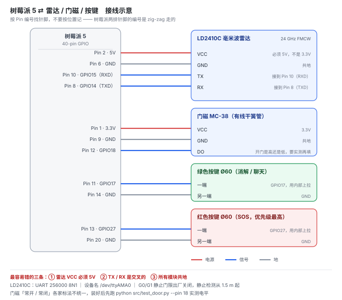

# 从零到一：实现步骤

> 写给第一次碰硬件的人。每一阶段都有**验收标准**——做不到那一条，不要往下走。
> 全程约 8–10 小时，可以拆成 4 个半天。

---

## 开工前：你手上要有这些东西

| 类别 | 具体 | 状态 |
|---|---|---|
| 硬件 | LD2410C 雷达（带排针裸模块）、有线门磁、Ø60 按键 ×2、0.96" OLED、ABS 150×100×70 外壳、铜箔、100µF 电容、杜邦线 | 约 100–150 元 |
| 主控 | 树莓派 5 + 5V/3A 电源 + TF 卡（已装系统） | 已有 |
| 电脑 | 能上网，装好 Git | — |
| 手机 | 能录音、能录像 | — |
| 账号 | GitHub（仓库）、PushPlus 或企业微信机器人（推送，可选） | 免费 |

**不要提前买的东西**：麦克风（语音识别是占位实现，买了也用不上）、无线门磁套装（多花钱还多一个配对环节）、带壳的 USB 雷达调试板（没法直插 GPIO）。

---

## 阶段 0：不需要硬件，今天就能做完

**预计 2 小时。做完了这个项目就已经"活了一半"。**

### 0.1 录六句语音

手机录音机，安静房间，离嘴 20 cm。

| 文件名 | 内容 | 情绪 |
|---|---|---|
| `ask.m4a` | 奶奶，有一阵子没看到您了，您还好吗？ | 慢，像真在问 |
| `ask_again.m4a` | 我有点担心，您按一下手边的键好吗？ | 略急，带担心 |
| `resolved.m4a` | 好的，您没事就好。 | 轻，松一口气 |
| `fault.m4a` | 设备好像有点问题，我让人来看看。 | 平，不带情绪 |
| `away.m4a` | 出门了呀，那我不打扰了。 | 快，随口 |
| `sos.m4a` | 紧急求助！请帮忙拨打 120 或联系家属！ | **喊出来** |
| `checkin.m4a`（可选） | 奶奶，我来看看您。您拍一下手边的键，我就放心了。 | 温和、慢，像每天的问安 |

**不要用机器合成音。** 这六句是项目里唯一"有温度"的部分，合成音会让它当场变成一个玩具。

第七句 `checkin` 是每日点名用的，**没录也能跑**（自动退回 `ask.wav`）。
但能录就录：它是这台设备唯一一次主动开口，早上九点说"有一阵子没看到您了"很别扭。

传到电脑，放进 `audio/`，然后：

```bash
python tools/audio_kit.py                    # 先看还缺什么
python tools/audio_kit.py 录音1.m4a ask      # 一条一条转
python tools/audio_kit.py 录音6.m4a sos
python tools/audio_kit.py                    # 六个全 OK 才算完
```

**验收**：`python tools/audio_kit.py` 输出「六个文件全部合格」。
**必做**：每转完一句，用播放器点开听一遍。体检验的是格式，**验不出内容配错**——
把 `resolved` 的录音命名成 `ask`，它会全绿，然后对着老人说"好的，您没事就好"。

> 常见失败：手机录的是 m4a，**改后缀名成 .wav 不算转换**。必须走上面的命令。
> 电脑没 ffmpeg 也能转（工具会自动用内置解码器），不用你装任何东西。

### 0.2 录 10 秒演示屏

```bash
python src/mock_run.py
```

对着屏幕录，只要这两行出现的那 4 秒：

```
[0096] ask        奶奶，有一阵子没看到您了，您还好吗？
[0101] resolved   好的，您没事就好。
```

存成 `demo/mock_run.mp4`。

**为什么这 10 秒比什么都重要**：一个不懂技术的人看完就明白——
设备先开口问，老人按下按钮，事件结束。不需要你解释。

### 0.3 建仓库并推上去

1. GitHub 网页 → New repository → 名字 `Guardian-Star-Elderly-Care`
2. **README、.gitignore、license 三个都不要勾**（建一个完全空的）
3. 复制 HTTPS 链接，然后：

```bash
cd C:/Users/user/WorkBuddy/2026-10-23-18-37-34/guardian
git remote add origin <你复制的链接>
git push -u origin main
```

**验收**：打开 GitHub 能看到 README、三张图、六段语音。

> 常见失败：建仓库时勾了 Add README → push 被拒（`failed to push some refs`）。
> 解决：`git pull origin main --allow-unrelated-histories`，处理完冲突再 push。

---

## 阶段 1：硬件到货当天（约 3 小时）

**这一阶段只有一个目标：让雷达出帧。别的都不要碰。**

### 1.1 先配系统（不接任何线）

树莓派开机，打开终端：

```bash
sudo apt update
sudo apt install -y alsa-utils          # 提供 aplay，播报要用
```

改 UART 配置：

```bash
sudo nano /boot/firmware/config.txt
```

在文件最后加**一行**：

```ini
dtparam=uart0=on
```

`Ctrl+O` 保存，`Ctrl+X` 退出，然后**重启**。

> **千万不要加** `dtparam=uart0_console`。那行会把串口变成登录控制台，正好占掉你要用的口，
> 程序会一直报"设备被占用"，你会查半天。

重启后确认两件事：

```bash
ls /dev/ttyAMA0                    # 应该存在
grep console /boot/firmware/cmdline.txt   # 里面有 console=serial0 就要删掉那一段
```

安装 Python 依赖：

```bash
cd ~/guardian          # 把仓库 clone 或拷到树莓派上
pip install pyserial --break-system-packages
```

> `--break-system-packages` 不是可选项。Pi OS Bookworm 之后 pip 默认拒绝全局安装，
> 不加这个参数会报 `externally-managed-environment`，网上很多教程还是老写法。
> `gpiozero` 系统自带，不用装。

### 1.2 接线



| 雷达引脚 | 接到树莓派 |
|---|---|
| VCC | Pin 2（**5V，不是 3.3V**） |
| GND | Pin 6 |
| TX | Pin 10（RXD） |
| RX | Pin 8（TXD） |

**TX 和 RX 是交叉的**：雷达的 TX 接树莓派的 RX。这是最容易接反的一处。

门磁：VCC → Pin 1（3.3V），GND → Pin 9，DO → Pin 12（GPIO18）。
按键：绿键 → Pin 11（GPIO17）+ GND；红键 → Pin 13（GPIO27）+ GND。

> 先在**裸板**上测，不要装壳。装壳之后再出问题，你分不清是壳挡了、线松了，还是代码错了。

### 1.3 验收：看到 10 帧/秒

```bash
python src/test_radar.py --port /dev/ttyAMA0
```

**验收标准**：终端连续滚动，每秒约 10 行，状态在 0/1/2/3 之间变化。手在雷达前挥一下，数字要动。

出 0 帧时，按这个顺序查（**别跳**）：

| 现象 | 排查 |
|---|---|
| 一行帧都没有 | 波特率是不是 256000（写成 115200 是常见错） |
| 还是没有 | TX/RX 是不是接反了（交叉） |
| 还是没有 | GND 接了没有（最容易忘的一条） |
| 报"设备被占用" | config.txt 里是不是加了 `uart0_console` |
| 报权限错误 | `sudo usermod -aG dialout $USER`，重新登录 |

### 1.4 门磁与按键

```bash
python src/test_door.py --pin 18        # 手动开合门，看电平变化
```

**验收**：门开时打印一个值，门关时打印另一个。记下"开门 = 1 还是 0"，后面要用。

> 门磁的"常开/常闭"各家标法不统一，不要信卖家描述，**只信实测**。

---

## 阶段 2：采集日（约 2.5 小时）

**这一阶段是项目本身。前面都是准备工作。**

**必须一次做完，不要拆成好几天**——不同天采集，房间布局、家具位置、路由器位置都变了，底噪不可比。

### 2.1 先测摆放距离（10 分钟）

裸板放在三个位置，各待 60 秒，看屏幕上的**静止能量**：

| 距离 | 预期 |
|---|---|
| 0.8 m（茶几高度） | **能量会塌下去**，状态在 0 和 2 之间乱跳 |
| 2.4 m（电视柜） | 稳定，能量 40–60 |
| 3.8 m（书架） | 仍能看到，但能量下降 |

**这张对比图直接证明"为什么不能放茶几"**，也是说明书第四节唯一有实测支撑的地方。
记下三组数字，别只拍照。

### 2.2 采五组数据（60–80 分钟）

```bash
python src/capture.py --label empty      --minutes 2
python src/capture.py --label sit        --minutes 5
python src/capture.py --label breathhold --minutes 3 --event-at 20
python src/capture.py --label lie        --minutes 3 --event-at 20
python src/capture.py --label exit       --minutes 3 --event-at 20 --pin-door 18
```

每组做两轮。`--event-at 20` 的意思是"第 20 秒做动作"：

| label | 第 20 秒你要做什么 |
|---|---|
| `breathhold` | 屏住呼吸、完全不动，能屏多久屏多久（**核心实验**） |
| `lie` | 躺到地上，不动，但**保持正常呼吸** |
| `exit` | 起身、开门、走出去、关门，在门外待满剩下的时间 |

**采之前先打印 `docs/采集记录表.md`**，边测边填环境和异常——这两项脚本记不下来，
但它们决定数据是否作废（比如采 `empty` 时室友进来了，这一组就废了）。

### 2.3 两个结果的读法（提前知道，避免误判）

**`breathhold`**：决定这个项目的天花板。

- 屏息 30 秒内就丢目标 → 雷达靠的是呼吸微动。真实衰弱老人呼吸更浅，**适用人群必须写窄**。
- 屏息 60 秒以上仍锁定 → 雷达靠的是更粗的体表微动，**结论比你预期好**。

两种结果都能用，但你必须知道是哪一种。

**`lie`**：如果结果是"雷达仍能看到"——**这是好消息**。
它证明躺着呼吸的人不会被误判为异常静默，也就用实测支撑了"我不做跌倒检测"这条边界。

---

## 阶段 3：出数、装壳（约 2 小时）

### 3.1 跑曲线，填指标

```bash
python src/sweep.py data/guardian.csv
```

**验收**：终端打印一张表，`sweep_result.csv` 生成在仓库根目录。

两条硬要求：

- `empty` 和 `lie` 两列的误问候必须是 **0**。不为 0 说明雷达在没人的房间里丢了人，比误问候严重得多。
- `exit`（离场）误问候必须是 **0**。不为 0，你的"门磁否决"卖点当场就破了。

把三个数填进 `docs/边界与指标.md`：静坐误问候次数/24h、屏息检出率、平均延迟。

> `sweep.py` 会提醒：静坐样本不到 30 分钟时，"误问候/24h"是从几分钟外推的。
> **答辩时不要报这个外推数**，报实测时长和次数即可。

### 3.2 装壳

| 注意 | 原因 |
|---|---|
| 雷达孔开在**顶盖前缘**，整体上倾 10° | 朝前不朝上；朝上就是对着天花板 |
| 雷达背面贴铜箔 | 挡后瓣（会看到背后的东西），顺便挡喇叭振动 |
| 雷达供电就近并 100µF 电容 | 电源纹波 >100 mV 时，安静房间会频繁误报"运动" |
| 按键装在前立面下部 | 老人按键时手在 0.3 m 处，别让它进雷达视场 |
| 喇叭和雷达之间塞泡绵 | 播报的振动会被当成微动，形成自激 |
| 不要金属漆、不要金属防尘网 | 24 GHz 会被挡死；塑料格栅可以 |

### 3.3 整机跑起来

```bash
python src/guardian_main.py --port /dev/ttyAMA0 --pin-door 18 --pin-button 17 --pin-sos 27
```

**验收**：人走出房间、门保持关闭，等 90 秒后听到 `ask.wav`；按绿键，听到 `resolved.wav`。

---

## 阶段 4：答辩前（约 2 小时）

1. **连续运行 24 小时**，日志里不能出现崩溃、不能出现同一次静默推送两次。
2. **彩排 3 分钟演示**：不看稿讲完"雷达发起 → 门磁否决 → 按键消解"，中间穿插 10 秒录屏。
3. **背 `docs/答辩问答.md`**，重点 Q1（防摔倒吗）、Q4（拔电源）、Q7（数据呢）。
4. **准备一句诚实的话**：被问到没做过的事，就说"这个我没测，写在边界里了"。

---

## 附：卡住时的排查顺序

| 症状 | 先查这个 | 再查这个 |
|---|---|---|
| 雷达 0 帧 | 波特率 256000 | TX/RX 交叉、共地 |
| 门磁不响应 | `test_door.py` 的电平 | 3.3V 供电（不是 5V） |
| 按键没反应 | 是否内部上拉（`pull_up=True`） | 另一端是否接 GND |
| 没声音 | `audio/` 里六个 WAV 在不在 | 树莓派上 `aplay` 装了没有 |
| 反复问候坐着的人 | 摆放距离 < 1.5 m | 灵敏度门限是否设反（100 = 完全屏蔽） |
| 该报不报 | 门磁是不是一直判"开" | 窗口占比阈值是否被改过 |
| `python src/xxx.py` 找不到文件 | 当前目录是不是仓库根目录 | — |

---

## 一句话收尾

> 这个项目的技术难度不高，难点全在**愿不愿意花那 2 小时，去一个真实的房间里，
> 测出三个只属于你的数字**。
>
> 别人可以复制你的代码，复制不了你那份 `guardian.csv`。
