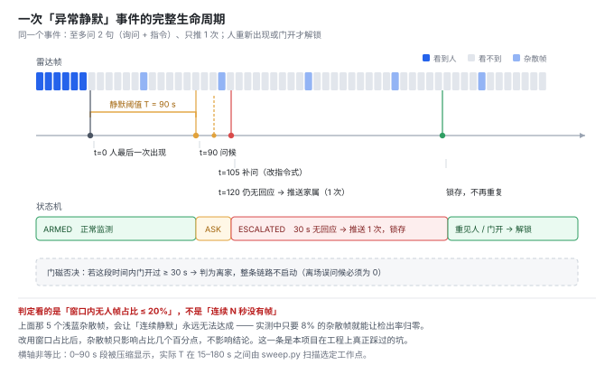
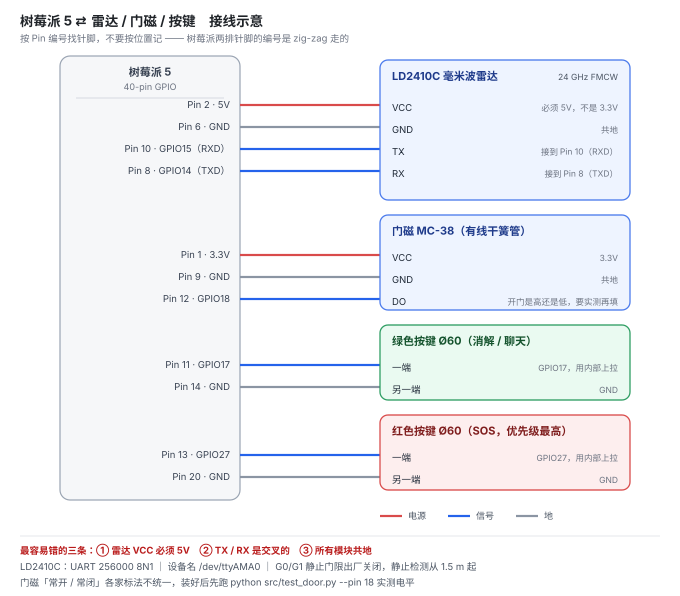

# 守护星 · 产品说明书

> 一台放在柜子上的盒子。房间里的老人长时间没有动静、也没有出过门，它会先开口问一句；
> 老人拍一下手边的大按钮，它就安静下来。**不回应，才通知家属。**

- 版本：v0.1（原型）
- 适用：独居或白天独处的老人，一个房间
- **不适用**：跌倒检测、医疗诊断、跨房间监护

---

## 一、它到底在做什么

它在盯一件很具体的事：

> **刚才还看得见人，现在看不见了，而且门没开过。**

不是"有没有人"，是"**人是不是从这里消失了、而且没有走出去**"。

这两个条件同时成立，它才开口。少一个都不动作：

| 情况 | 它看到什么 | 它怎么做 |
|---|---|---|
| 老人坐在沙发上看电视，一动不动 | 雷达一直看得到（呼吸微动） | 什么都不做 |
| 老人起身开门出去了 | 门磁先报"门开了" | 判为离家，**不问候** |
| 老人去卫生间（门没关） | 雷达偶尔看得到 | 窗口内占比够，不判定 |
| 老人在卧室睡着了（跨房间） | 雷达看不到 | **这是本设备的盲区，见第五节** |
| 老人倒地不起，仍在呼吸 | 雷达仍看得到 | 不判定（**所以它不防跌倒**） |
| 老人倒地后呼吸微弱，雷达丢失目标 | 看不到 + 门没开 | 问候 → 无回应 → 通知家属 |

最后两行的区别，是这个产品最需要讲清楚的地方。

---

## 二、一次完整的事件

1. **计时**：雷达最后一次看到人，开始计时。
2. **阈值**：静默超过 T 秒（默认 90 秒）。
   - 判定用的是**窗口内"无人帧"占比 ≥ 80%**，不是"连续 90 秒一帧都没有"。
   - 为什么：真实的雷达每隔十几秒就会冒一帧误检。按"连续"判定，计时器永远被打断，等于永远不报警。
3. **问候**：播一句真人录音——"奶奶，有一阵子没看到您了，您还好吗？"
4. **等待 30 秒**，看有没有人按按钮。
5. **按了** → 播"好的，您没事就好"，本次事件结束，之后 10 分钟不再打扰。
6. **没按** → 再问一次，仍然没回应 → 推送给家属，**同一次静默只推一次**。
7. **解锁**：直到雷达重新看到人，或者门被打开（说明有人进出）。

> 同一次静默，"问"最多 2 次，"推"只有 1 次。
> 这条规则比检出率更重要——**设备不是坏掉的，是被嫌烦拔掉的。**

---

## 三、三个键与一盏灯

| 部件 | 位置 | 作用 |
|---|---|---|
| 绿色大按钮 Ø60 | 前立面，中心距底 28 mm | 问候时按 = "我没事"；平时按 = 想聊天 |
| 红色按钮 Ø60 | 绿色右侧 | 紧急求助，优先级最高，任何时候按下立刻播 SOS 并推送 |
| 0.96" OLED | 顶盖前部 | 显示状态，字大、只显示一句话 |
| 指示灯 ×2 | 按键左右 | 问候时缓慢呼吸，其余时间熄灭 |

**为什么不给老人一个 App**：老人不用 App。所有操作只有一个动作——拍按钮。
子女不需要装任何东西（推送走微信 / PushPlus）。

**按键的双重含义怎么处理**：只要设备处于"正在问候"或"已经升级"状态，按键一律判为"我没事"；
只有事件结束后，按键才唤醒聊天。老人不需要记规则。

---

## 四、怎么摆（这一条决定它能不能工作）

| 位置 | 到常坐位置的距离 | 判定 |
|---|---|---|
| 电视柜 / 餐边柜 / 书架 | 2–3 m，高 60–90 cm | **推荐** |
| 沙发侧后方边几 | 1.5–2 m | 可用，需标定 |
| 茶几 | 0.8 m | **不可用** |
| 床头柜 | 0.5 m | **不可用** |
| 空调出风口下、窗帘旁、风扇正对 | — | **不可用** |

**为什么不能放茶几**：LD2410 共 9 个距离门，每门 0.75 m。
**G0（0–0.75 m）与 G1（0.75–1.5 m）的静止门限出厂为 0，即关闭**——官方理由是这两门太近，被噪声和反射主导。
所以静止检测实际从 **1.5 m** 起。

放茶几的后果不是"精度差一点"，而是**结论反了**：老人明明坐在 0.8 m 处，雷达报"无人"，
于是设备每 T 秒对着坐在它面前的人问一次"奶奶您还好吗"。

**其他三条硬约束**：

1. 雷达**只能朝前**，不能朝上（朝上就是对着天花板）。开孔开在顶盖**前缘**，不是正中，整体上倾 10°。
2. **按键不要和雷达同在前立面**：老人按键时手在 0.3 m 处，正好在近场搅动。
3. 喇叭与雷达**不同腔**，中间塞泡绵隔断；播报期间冻结判定 3 秒（代码里已有 `speech_freeze`）。

---

## 五、它做不到什么（必须一起说明）

1. **不做跌倒识别。** 它不识别姿态，测不到"倒下那个动作"。倒在地上仍在呼吸的人，雷达照样看得见——**这是它主动放过的情况**。
2. **一台只覆盖一个房间。** 卫生间、厨房、跨房间是盲区。老人每天进出卫生间 6–10 次，是这个场景最大的误触发来源，本方案盖不住。
3. **单颗雷达分不清"出门"和"失能"。** 两者在信号上可能完全一样（目标消失）。所以用门磁否决"出门"，用按键消解"无法判断"。
4. **需要 ≥ 1.5 m 摆放距离。** 见第四节，这不是建议，是物理限制。
5. **断电即失效，断网只失去远程通知。** 安全播报用本地预录 WAV，不走云端 TTS；但设备断电、雷达失效期间不具备任何监护能力。
6. **不宣称符合 MZ/T 238—2025。** 该标准为民政部推荐性行业标准（2025-02-28 发布、2025-05-01 实施），本方案仅参照其功能框架，且不覆盖其中的跌倒检测要求。
7. **不用于医疗诊断，不输出任何生理参数。**

---

## 六、规格

| 项 | 值 |
|---|---|
| 主控 | 树莓派 5（5V/3A） |
| 感知 | HLK-LD2410C，24 GHz FMCW，UART 256000 8N1 |
| 门磁 | 有线干簧管 MC-38（GPIO18） |
| 显示 / 交互 | 0.96" OLED（I²C）+ Ø60 自复位按键 ×2 |
| 外壳 | ABS 150×100×70，透明盖 |
| 功耗 | 约 3–5 W（整机含树莓派） |
| 网络 | 仅用于推送家属与可选聊天，安全路径不依赖 |
| 物料增量成本 | **约 100–150 元**（不含已有树莓派） |
| 默认参数 | T = 90 s，等待 30 s，离家确认 30 s，消解后静默 10 min |

---

## 七、故障时它会怎么表现

| 现象 | 含义 | 处理 |
|---|---|---|
| 开机 60 秒无人，播"启动 5 秒仍未检测到人" | 摆位不对或雷达没连上 | 挪到 2–3 m，检查接线 |
| 播"设备好像有点问题，我让人来看看" | 5 秒内收不到任何雷达帧 | 查 UART：波特率 256000、TX/RX 交叉、共地 |
| 该问候时不问候 | 大概率是摆太近（< 1.5 m） | 见第四节 |
| 反复问候坐着的人 | 同上，或灵敏度门限设反了 | 门限 100 = 该门**完全不识别**，数字越大越迟钝 |

> **最危险的失效不是报错，是"看起来在工作"。**
> 所以它上电会做一次自检，并且每 5 秒检查一次雷达心跳——收不到帧就报"设备异常"，
> 而不是把"雷达坏了"当成"人消失了"。

---

## 八、隐私

- 不使用摄像头，不采集图像、声音、视频。
- 雷达只输出"有没有人、动不动、多远、能量多少"，**不产生任何可识别的个人信息**。
- 本地不存储录音；六句播报是固定音频文件。
- 推送内容只有一句文字（如"老人较长时间未活动且未回应问候，建议致电确认"）。
- 可选的大模型聊天功能需要联网，且**与安全功能完全隔离**：聊天挂了、断网了，守护功能不受影响。

---

## 九、一句话总结

> 它不承诺"发现所有意外"，它承诺的是：
> **在该有人的房间里，人安静太久又没出门，它会问一句；问了没人应，才告诉家属。
> 而且同一次意外，只打扰一次。**
