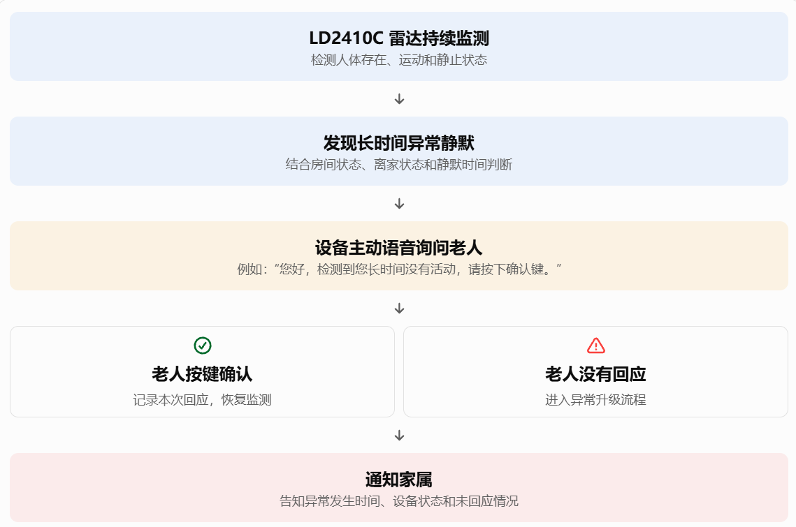
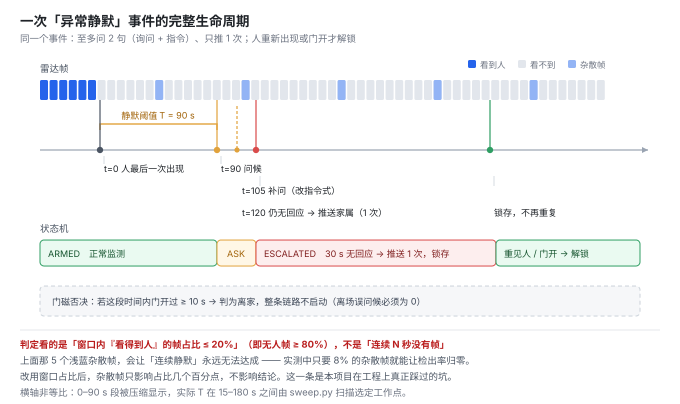
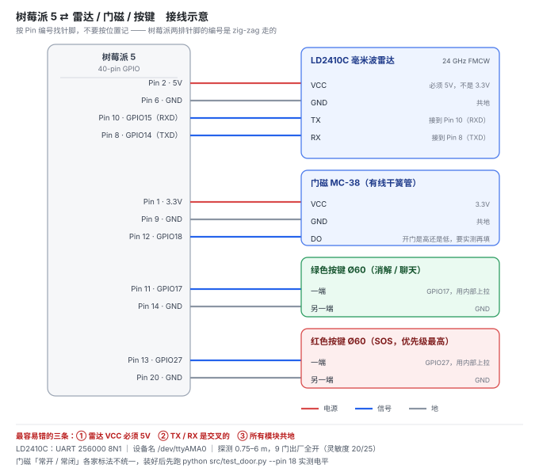

# 守护星 · 产品说明书

> 一台放在柜子上的盒子。房间里的老人长时间没有动静、也没有出过门，它会先开口问一句；
> 老人拍一下手边的大按钮，它就安静下来。**不回应，才通知家属。**

- 版本：v0.1（原型）
- 对外名称：独居老人桌面静默关怀终端（本文件用"异常静默确认终端"——多"确认"两个字，
  因为**先问一句再决定**才是这个产品区别于"报警器"的地方）
- 适用：独居或白天独处的老人，一个房间
- **不适用**：跌倒检测、医疗诊断、跨房间监护

---

## 〇、一页速览（没时间读全文就看这里）

> **口号：懂分寸、不瞎报、能救命。**
> 它不是"更准的跌倒检测"，它回答的是另一个问题：**最坏情况下，多久一定有人知道。**

**当前阶段（说清楚，别含糊）**：树莓派 5 原型，红绿两个实体按键与音箱已就绪；
雷达、门磁、麦克风在途。无硬件时用 `src/mock_run.py`（自动剧本）或
`src/demo_keyboard.py`（键盘模拟，现场演示用），**两者跑的都是 `guardian.py` 里同一套状态机**。

**三种人，别混为一谈**

| 角色 | 是谁 | 在意什么 |
|---|---|---|
| 使用人 | 独居、白天独处、排斥穿戴与摄像头的老人 | 别烦我、别拍我、我说了算 |
| 决策人 | 子女 | 出事有没有人告诉我 |
| 付费人 | 子女 / 社区养老站点 | 多少钱、出了事谁负责 |

**功能清单（哪些有、哪些明确没有）**

| 有 | 没有 |
|---|---|
| 静默询问：雷达看不见人且门没开 → 先问一句 | 跌倒姿态识别 |
| 绿键消解：拍一下，本次事件结束，不通知子女 | 摄像头、录音上传 |
| 红键 SOS：不看任何条件，按下就呼救 | 跨房间 / 卫生间监护 |
| 家属推送：PushPlus 微信消息，同一次静默只推一次 | 医疗诊断、生理参数 |
| 每日点名：9:00 / 20:00 各问一次，按了发「今日平安」 | 自主 Agent、自动叫 120 |
| AI 陪聊：DeepSeek，**与安全链路完全隔离** | 语音控制家电 |

**四条设计取舍（也是四个创新点）**

1. **双条件物理校验**：雷达"看不见人" **且** 门没开过，才进入判定。单靠雷达分不清"出门"和"失能"。
2. **分级确认**：先问 → 30 秒内可按键提前消解 → **到点无论有没有人按，都升级通知**（按键不是前置条件）。
   同一次静默最多问 2 次、只推 1 次，把"打扰"当成硬约束。
3. **AI 与安全解耦**：判定全在本地规则里，大模型只陪聊；它挂了、断网了，守护不受影响。
4. **每日点名兜底**：把"人在但动不了"的无界盲区，变成**最长 13 小时**的有界承诺；
   顺带让"设备被拔掉"变成可观测事件（收不到「今日平安」）。

**社会价值**：用一百多元的外围器件，补上居家养老里"出事没人知道"这一段——
不增加被监护感，也不把成本转嫁给老人。

---

## 一、它到底在做什么

它在盯两件事，缺一不可：

> **① 刚才还看得见人，现在看不见了，而且门没开过。**
> **② 人还在，但一天两次问它，它一次都不应。**

第一条抓的是"人消失了"，第二条抓的是"人还在、但动不了"。
只有第一条，它会漏掉倒地不起还在呼吸的人；只有第二条，半夜出事要等到早上才有人知道。



> 这张图是**异常静默**这一条主线。每天的 9:00 / 20:00 点名是另一条独立入口（见第二节），
> 两条线共用"问一句 → 等按键 → 没回应就通知家属"这同一个确认动作。
>
> 图里第三块的示例话术是示意，**实际播报以 `audio/` 里的七段真人录音为准**：
> 第一句是询问（"奶奶，有一阵子没看到您了，您还好吗？"），第二句才转成指令（"您按一下手边的键好吗"），
> 两句不是重复，是刻意换的说法。

| 情况 | 它看到什么 | 它怎么做 |
|---|---|---|
| 老人坐在沙发上看电视，一动不动 | 雷达一直看得到（呼吸微动） | 平时不打扰；**每天 9:00 / 20:00 各问一句"我来看看您"** |
| 老人起身开门出去了 | 门磁先报"门开了" | 判为离家，**不问候、不点名** |
| 老人去卫生间（门没关） | 雷达偶尔看得到 | 窗口内占比够，不判定 |
| 老人在卧室睡着了（跨房间） | 雷达看不到 | **这是本设备的盲区，见第五节** |
| 老人倒地不起，仍在呼吸 | 雷达仍看得到，静默判定不触发 | **靠每日点名发现：问一句 → 不按 → 通知家属** |
| 老人倒地后呼吸微弱，雷达丢失目标 | 看不到 + 门没开 | 90 秒后问候 → 30 秒无应答 → 通知家属 |

最后两行覆盖的是同一件事的两半，也是这个产品最需要讲清楚的地方：
**雷达看得见但人动不了，靠点名；雷达看不见了，靠静默判定。**

### 它承诺的到底是什么

客户真正买的不是"跌倒检测"，是**"最坏情况下，多久一定有人知道"**。这张表才是产品：

| 场景 | 最坏多久有人知道 | 靠什么 |
|---|---|---|
| 人从雷达里消失（呼吸停止、滑到地上、离开视场） | **约 2 分钟**（T 90 s + 应答 30 s） | 静默检测 |
| 人还在、但动不了也不应答 | **约 13 小时**（20:00 之后出事 → 次日 9:00 点名） | 每日点名 |
| 设备被拔掉 / 断线 / 死机 | **当天就会暴露**（前提：家属在核对"今天该收到一条"） | 每日平安推送 |

第三行是意外收获，却可能是最值钱的一条：**市面上大量设备不是坏掉的，是被嫌烦拔掉的**。
一台被拔掉的设备是"安静地消失"，没人知道；而这台每天会报一次平安，
它一沉默，家属当天就会发现。

---

## 二、一次完整的事件



1. **计时**：雷达最后一次看到人，开始计时。
2. **阈值**：静默超过 T 秒（默认 90 秒）。
   - 判定用的是**窗口内"无人帧"占比 ≥ 80%**，不是"连续 90 秒一帧都没有"。
   - 为什么：真实的雷达每隔十几秒就会冒一帧误检。按"连续"判定，计时器永远被打断，等于永远不报警。
3. **问候**：播一句真人录音——"奶奶，有一阵子没看到您了，您还好吗？"
4. **等 15 秒**，没按就补问第二句："我有点担心，您按一下手边的键好吗？"
   - 第二句不是重复。第一句是**询问**，第二句是**指令**——对听力差、反应慢的老人，这是两句不同的话。
5. **按了** → 播"好的，您没事就好"，本次事件结束，之后 10 分钟不再打扰。
6. **从第一句算起 30 秒仍没按** → 推送给家属，**同一次静默只推一次**。
7. **解锁**：直到雷达重新看到人，或者门被打开（说明有人进出）。

> 同一次静默，"问"最多 2 次，"推"只有 1 次。
> 这条规则比检出率更重要——**设备不是坏掉的，是被嫌烦拔掉的。**

### 另一条入口：每日点名

上面这条链路抓的是"人消失了"。但人在、只是动不了的时候，它永远不会触发。所以每天还有两次主动点名：

1. **9:00 / 20:00 到点**，先看一眼雷达：房间里有人的话，问一句"奶奶，我来看看您。您拍一下手边的键，我就放心了。"
2. **按了** → 播"好的，您没事就好"，同时给家属记一条"今日平安"。
3. **30 秒没按** → 推送家属。
4. **房间里没人** → 不问（那是出门或静默判定的事，不冲空房间说话）。
5. **老人刚按过键或刚聊过天** → 这次点名免掉，不然就是"刚聊完天又被问一句"。

点名的时刻是用**当天时间**算的，不是设备运行时长。所以重启不会把时间推后，家属永远能预期"早上九点它会问一句"。每分钟问一句的那种设备叫闹钟，不叫守护。

---

## 三、两个键（这是全部交互）

| 部件 | 位置 | 作用 | 当前版本 |
|---|---|---|---|
| 绿色大按钮 Ø60 | 前立面，中心距底 28 mm | 问候时按 = "我没事"；平时按 = 想聊天 | **已实现** |
| 红色按钮 Ø60 | 绿色右侧 | 紧急求助，优先级最高，任何时候按下立刻播 SOS 并推送 | **已实现**（接线 Pin 13 / GPIO27，启动须传 `--pin-sos 27`） |
| 0.96" OLED | 顶盖前部 | 显示状态，字大、只显示一句话 | 预留：**代码尚未驱动**，装了也不亮 |
| 指示灯 ×2 | 按键左右 | 问候时缓慢呼吸，其余时间熄灭 | 预留：**代码尚未实现** |

> 上面两行"预留"是产品形态规划，不是当前能力。**答辩演示时不要指着一块黑屏说它显示状态**——被问一句"它现在显示什么"就没有退路。宁可说"这两个件我留了位置，还没写驱动"。

**为什么不给老人一个 App**：老人不用 App。所有操作只有一个动作——拍按钮。
子女不需要装任何东西（推送走微信 / PushPlus）。

**按键的双重含义怎么处理**：只要设备处于"正在问候"或"已经升级"状态，按键一律判为"我没事"；
只有事件结束后，按键才唤醒聊天。老人不需要记规则。

---

## 四、怎么摆（这一条决定它能不能工作）



| 位置 | 到常坐位置的距离 | 判定 |
|---|---|---|
| 电视柜 / 餐边柜 / 书架 | 2–3 m，高 60–90 cm | **推荐** |
| 沙发侧后方边几 | 1.5–2 m | 可用，需标定 |
| 茶几 | 0.8 m | **不推荐**（G1 门内，需实测） |
| 床头柜 | 0.5 m | **不推荐**（G0 门内，需实测） |
| 空调出风口下、窗帘旁、风扇正对 | — | **不可用** |

**关于近距离：以官方文档为准，别信我之前的说法**

海凌科《LD2410C 说明书 V1.09》表 2 写的是：

> **探测距离 0.75 m ～ 6 m，可调**；距离分辨率 0.75 m；共 9 个距离门（G0–G8），每门 0.75 m。

也就是说**物理下限是 0.75 m，不是 1.5 m**。

**出厂灵敏度也不是 0。** 官方「读取参数」ACK 示例逐字节是：

```
运动灵敏度 G0..G8 = 20（0x14）全同
静止灵敏度 G0..G8 = 25（0x19）全同
无人持续时间     = 5 秒
```

九个门全部开着，没有哪个门被出厂关闭。

> **这里订正一处旧错**：本文档早期版本写过「G0/G1 静止门限出厂为 0、静止检测实际从 1.5 m 起」，
> 那是**推断而不是文档事实**，逐字节核对官方 ACK 后确认不成立。
> 另外官方原文里「最远距离门设为 2，则只在 **1.5 m 内**有效」说的是**上限**，
> 我一度读成了下限，方向正好反了。

**那为什么仍然推荐 2–3 m？** 三个工程理由，不是物理限制：

1. **0.75 m 内是 G0 单门**，分辨率只有 0.75 m，人在这个门里"动一下"和"坐着不动"的区分度最低；
2. **近场反射强**：雷达后瓣打到桌面/墙面再回来，会把静止能量抬高，坐着的人和空椅子分不开；
3. **放在 0.8 m 会正对老人的后背或侧身**，胸腔起伏方向与雷达波束接近垂直，微动最难测。

所以：**能放 2–3 m 就别放 0.8 m，但「0.8 m 一定不可用」这句话我说错了。**
真要在近距用，必须做一步实测：坐在目标位置 60 秒，看工程模式的 G0/G1 静止能量是否稳定高于空场基线。

放茶几的真正风险不是"精度差一点"，而是**结论可能反了**：老人坐在 0.8 m 处，若 G0 静止能量被桌面反射淹没，
雷达报"无人"，设备就会每 T 秒对着坐在它面前的人问一次"奶奶您还好吗"。
**这要靠实测确认，不能靠推理确认。**

**其他三条硬约束**：

1. 雷达**只能朝前**，不能朝上（朝上就是对着天花板）。开孔开在顶盖**前缘**，不是正中，整体上倾 10°。
2. **按键不要和雷达同在前立面**：老人按键时手在 0.3 m 处，正好在近场搅动。
3. 喇叭与雷达**不同腔**，中间塞泡绵隔断；播报期间状态机会按音频真实时长冻结判定（`phrase_seconds()` 读 WAV 头，`speech_freeze` 仅作兜底）。

---

## 五、它做不到什么（必须一起说明）

1. **不做跌倒识别。** 它不识别姿态，测不到"倒下那个动作"。倒在地上仍在呼吸的人，雷达照样看得见——静默判定不会触发，**只能等到下一次每日点名才会被发现（最坏约 13 小时）**。这是本设备最大的时间盲区，写在这里，不藏。
2. **一台只覆盖一个房间。** 卫生间、厨房、跨房间是盲区。老人每天进出卫生间 6–10 次，是这个场景最大的误触发来源，本方案盖不住。
3. **单颗雷达分不清"出门"和"失能"。** 两者在信号上可能完全一样（目标消失）。所以用门磁否决"出门"，用按键消解"无法判断"。
4. **推荐 2–3 m 摆放，物理下限 0.75 m。** 出厂 9 个门全开（灵敏度 20/25），但 0.75 m 内只有 G0 单门、分辨率 0.75 m，近场反射会抬高静止能量。近距使用必须先实测 G0/G1 的静止能量是否稳定高于空场。
5. **断电即失效，断网只失去远程通知。** 安全播报用本地预录 WAV，不走云端 TTS；但设备断电、雷达失效期间不具备任何监护能力。**唯一的补偿是每日点名的回执**：家属当天收不到"今日平安"，就知道要打个电话或上门看一眼。**这条有三个前提，缺一个就不成立**：配了推送 token；设备每天确实发一条；家属知道"每天都该有一条"。它是一条使用约定，不是设备自己检出来的能力——断电的设备报不了自己的死讯。
6. **门长时间不关、人又离开雷达视场时，判为离家，不监护。** 门开着但雷达还看得见人，仍然是正常在家状态；一旦"门开 + 看不见人"，单靠门磁与雷达无法区分"出门了"和"倒在门外楼道"，本设备按出门处理。夏天开门通风、等人时长时间敞着门，就是这条边界的现实触发场景。
7. **点名依赖老人愿意按。** 明确拒绝按的老人，点名会退化成"每天两次没人应的推送"——那时它是一台提醒家属的设备，不是一台监护设备。这条也要提前跟家属说清楚。
8. **不宣称符合 MZ/T 238—2025。** 该标准为民政部推荐性行业标准（2025-02-28 发布、2025-05-01 实施），本方案仅参照其功能框架，且不覆盖其中的跌倒检测要求。
9. **不用于医疗诊断，不输出任何生理参数。**
10. **语音识别只做输入端，永不参与安全判定。** 本地离线小模型，限制三条：**5 秒定长录音、需相对安静、仅对标准普通话有效**。方言、含糊发音、距离过远都会识别失败。因此它只用于陪聊，静默判定与告警升级全程不读这段文本——**识别错了最多是聊得不好，不会漏救，也不会乱报警**。
11. **OLED 与指示灯为预留，当前版本未驱动。** 已实现的人机通道只有两个按键 + 扬声器。写在这里，是因为"屏幕上会显示状态"是最容易被观众默认成立的一件事。

---

## 六、规格

| 项 | 值 |
|---|---|
| 主控 | 树莓派 5（5V/3A） |
| 感知 | HLK-LD2410C，24 GHz FMCW，UART 256000 8N1 |
| 门磁 | 有线干簧管 MC-38（GPIO18） |
| 显示 / 交互 | Ø60 自复位按键 ×2（已实现）；0.96" OLED 与指示灯为**预留**，当前代码未驱动 |
| 外壳 | ABS 150×100×70，透明盖 |
| 功耗 | 约 3–5 W（整机含树莓派） |
| 网络 | 仅用于推送家属与可选聊天，安全路径不依赖 |
| 物料增量成本 | **必购约 157 元**（不含已有树莓派，见 [hardware/采购申请单.md](../hardware/采购申请单.md)） |
| 默认参数 | T = 90 s，回应窗 30 s（15 s 时补问一句），离家确认 10 s，短时开关门压制 120 s，消解后静默 10 min，每日点名 9:00 / 20:00 |

---

## 七、故障时它会怎么表现

| 现象 | 含义 | 处理 |
|---|---|---|
| 上电 60 秒无人，播「启动 60 秒仍未检测到人，请检查摆放位置」（演示配置为 5 秒） | 摆位不对或雷达没连上 | 挪到 2–3 m，检查接线 |
| 播"设备好像有点问题，我让人来看看" | 5 秒内收不到任何雷达帧 | 查 UART：波特率 256000、TX/RX 交叉、共地 |
| 该问候时不问候 | 可能摆太近（G0 单门，近场反射淹没静止能量） | 见第四节，先实测再挪位 |
| 反复问候坐着的人 | 同上，或灵敏度门限设反了 | 门限 100 = 该门**完全不识别**，数字越大越迟钝 |

> **最危险的失效不是报错，是"看起来在工作"。**
> 所以它上电会做一次自检，并且每 5 秒检查一次雷达心跳——收不到帧就报"设备异常"，
> 而不是把"雷达坏了"当成"人消失了"。

---

## 八、隐私

- 不使用摄像头，不采集图像、声音、视频。
- 雷达只输出"有没有人、动不动、多远、能量多少"，**不产生任何可识别的个人信息**。
- 本地不存储录音；七句播报是固定音频文件。
- 推送内容只有一句文字（如"老人较长时间未活动且未回应问候，建议致电确认"）。
- 可选的大模型聊天功能需要联网，且**与安全功能完全隔离**：聊天挂了、断网了，守护功能不受影响。

---

## 九、一句话总结

> 它不承诺"发现所有意外"，它承诺的是两件有时间上限的事：
> **人从房间里消失（门没开），2 分钟内我会问一句；问了没人应，就告诉家属。**
> **人还在但动不了，最晚到下一次点名（9:00 / 20:00）我也一定会问。**
> 同一次意外，只打扰一次。而我每天都在报平安——**哪天我不报了，你就该来看一眼。**
